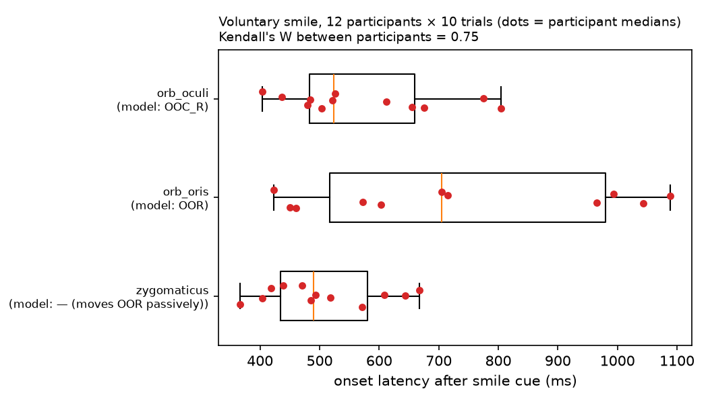
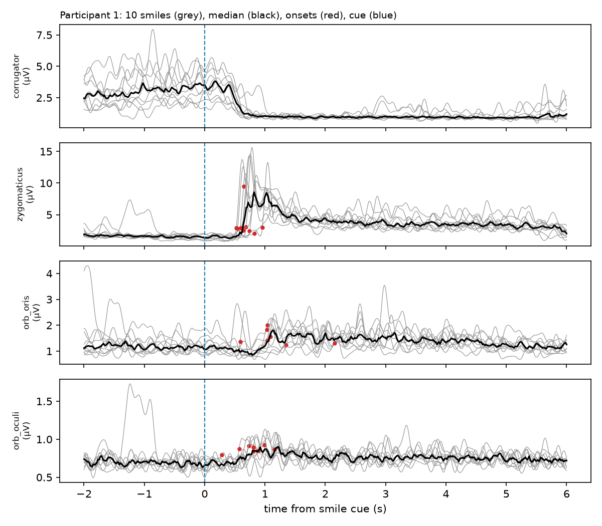
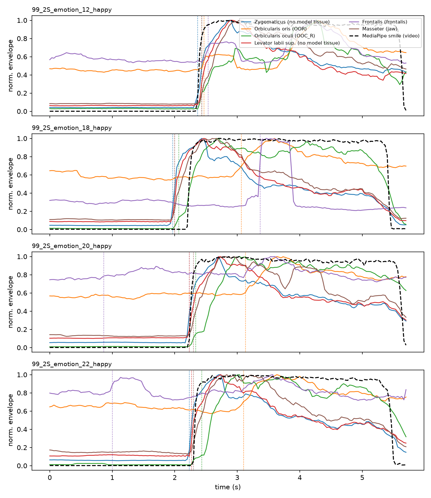

# B1 — Biological ground truth: muscle activation order during "happy"

**Question.** When a person smiles, in what order do the facial muscles switch on, how
consistent is that order, and does it match the motion order produced by the lab's
simulation (`a3-stochastic-V1`)?

**Caveat about the model.** The simulation uses a constant muscle activation
(`activation = 0.8`, `a3-stochastic-V1-algo/training/analysic_gradient/pytorch_analytical_gradient.py`),
so it has no activation *timing*. We therefore compare EMG onset order with the model's
tissue *motion* onset order, and real *video* motion onset with model motion onset.

## Data

Raw data lives in `data/` (gitignored, never commit it; MMM forbids redistribution).

| Dataset | Use | Subjects | Signal | License | Source |
|---|---|---|---|---|---|
| Mimetic Interfaces 2015 (Tampere) | main analysis | 15, 10 smiles each | raw sEMG 2048 Hz: zygomaticus, orb. oris, orb. oculi, corrugator / masseter (right side) | CC BY 4.0 | [research.fi](https://research.fi/en/results/dataset/0f24bf09-c5d1-422e-8df5-eb44219f5dec) |
| MMM sample (open part of MaM / EIFER) | cross-check + video motion | 1, 4 happy clips | 22-ch RMS envelope at 30 Hz (500 ms window) + video + MediaPipe blendshapes | see `LICENSE.md`, no redistribution | [zenodo 16636409](https://zenodo.org/records/16636409) |

Full MaM (many participants) is on request: <https://forms.gle/PBFzGwuSeMYMFVbz6>. Check with Viktor first.

## Method

`src/emg.py`:
- **Envelope** (raw data): remove DC → 4th-order Butterworth band-pass 20–450 Hz (zero phase)
  → notch at mains + harmonics → full-wave rectify → 6 Hz low-pass.
- **Onset**: first sample where the envelope exceeds max(baseline mean + 3 SD,
  baseline + 10 % of the rise to peak) for ≥ 50 ms (≥ 100 ms for 30 Hz data). Threshold rule after
  Hodges & Bui (1996). The 10 % floor stops smooth envelopes from firing on drift.
- **Activation ratio**: peak / baseline. Channels near 1 are treated as "not active".
- **Consistency**: Kendall's W across trials/participants, Kendall's τ between two orders.

`tests/test_emg.py` checks onsets are recovered on synthetic bursts with known timing.

## Results so far

### Mimetic Interfaces 2015 — main result (`src/mimetic_smile.py`)

12 participants (authors' exclusions 6, 7, 14 applied) × 10 voluntary smiles, raw 2048 Hz,
latency measured from the smile cue; baseline = the preceding neutral task.
Files are MATLAB `table` objects; read via `mat-io` (raw fields: `Eraw` µV, `L` task labels).



| | zygomaticus | orbicularis oculi | orbicularis oris | corrugator |
|---|---|---|---|---|
| peak / baseline | 8.6 | 4.3 | 2.9 | 1.3 (inactive; actually *relaxes*) |
| lag vs zygomaticus | — | **+35 ms**, later in 10/12, Wilcoxon p = 0.012 | **+188 ms**, later in 11/11, p = 0.001 | — |

- Order **zygomaticus → orbicularis oculi → orbicularis oris** in 8 of 11 participants with all three.
- Kendall's W between participants = **0.75** (strong agreement); within participants across
  10 trials median **0.53** (range 0.16–0.86): the order is a population tendency, with trial-to-trial variability.
- Same order as the independent MMM sample below.
- Caveats: orb. oris / oculi are low amplitude, so single-trial onsets are noisy; the small
  oculi lag (35 ms) could partly be crosstalk from zygomaticus; right side only; posed smiles.



### Model poses (`backup/b31 dataV22 backup hub` on `main`)

Mean vertex displacement from neutral (state `1`):

| Pose | OOR | OOC_L | OOC_R | Frontalis |
|---|---|---|---|---|
| AU12 | 2.8 | 0 | 0 | 0 |
| AU6 | 0.9 | 0.9 | 1.2 | 0 |
| AU6_12_25 | 5.2 | 1.3 | 1.6 | 0 |

The model's AU12 "smile" does not involve the eyes; **AU6_12_25 is the closest to "happy"** and matches
the EMG pattern (lips + eyes, no forehead). Only neutral→AU12 and neutral→AU6 trajectories exist
(GrUVi cloud disk, paths in `deformation_path_db.json`); neutral→AU12 and →AU12L point at the same job.

### MMM, 1 participant, 4 happy clips (`src/mmm_happy.py`)



- Order: **zygomaticus ≈ levator labii sup. ≈ masseter → video smile → orbicularis oculi → orbicularis oris (~0.9 s later)**.
- Orbicularis oris is only weakly active (peak/baseline 1.7) and rises late in 3/4 clips.
- Frontalis is not active in happy (1.5) → excluded from ordering.
- Kendall's W across the 4 clips: 0.50 (frontalis noise included; to recompute without it).
- Caveat: 30 Hz with a 500 ms RMS window → onset resolution ≈ 33 ms and onsets smeared early.

## Run

```bash
python3 -m venv .venv && .venv/bin/pip install numpy scipy pandas matplotlib mat-io
.venv/bin/python tests/test_emg.py
cd src && ../.venv/bin/python mimetic_smile.py && ../.venv/bin/python mmm_happy.py
```

## Citations

Büchner et al., CVPR 2025 (EIFER); Büchner et al., Acivs 2023 (MC-CycleGAN);
Guntinas-Lichius et al., Sci. Rep. 2023; Rantanen et al., Mimetic Interfaces dataset 2015;
Hodges & Bui, EEG Clin. Neurophysiol. 1996 (onset detection).
