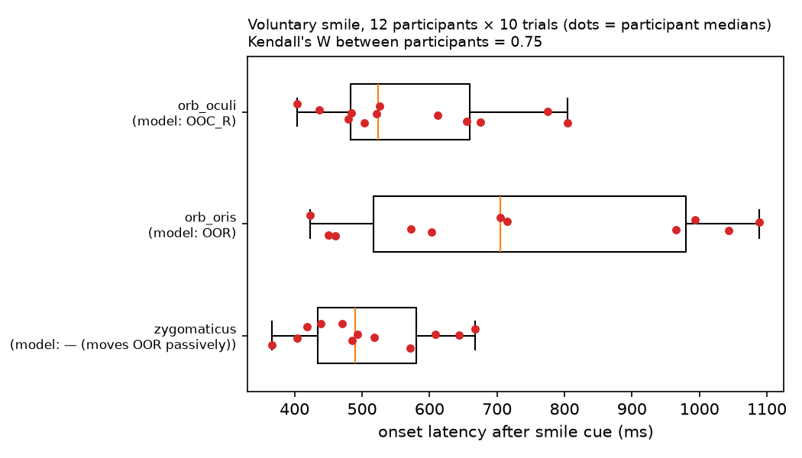
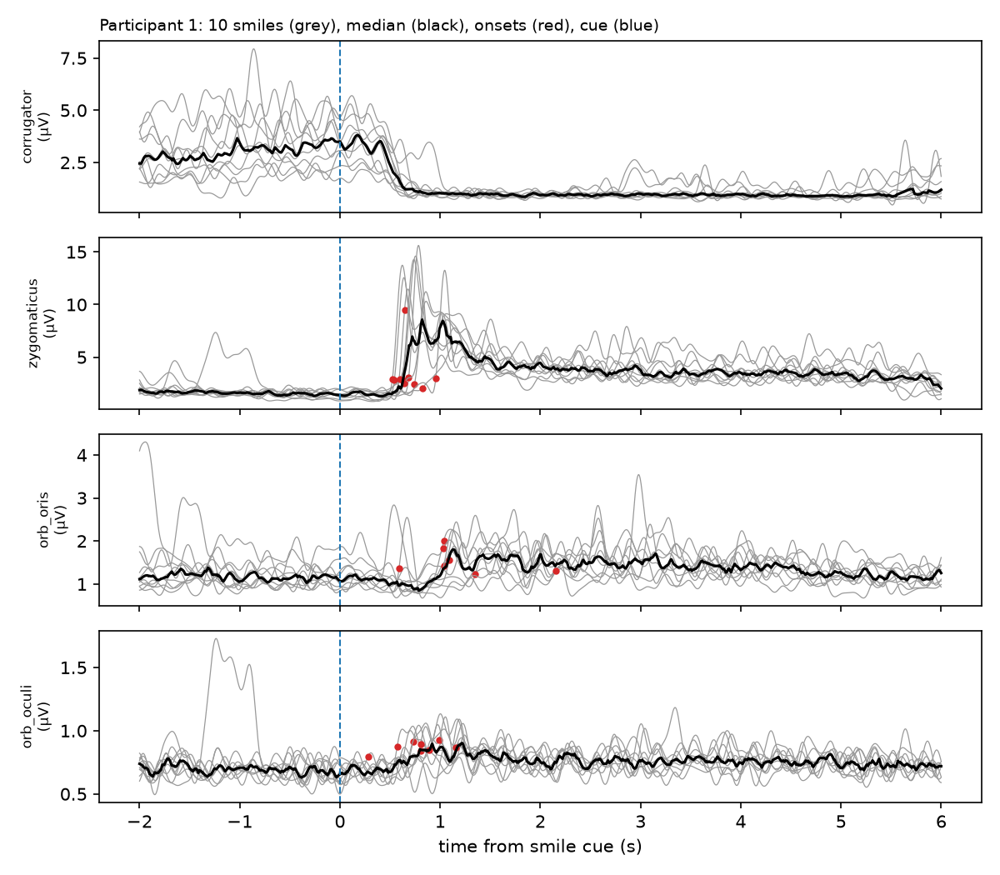
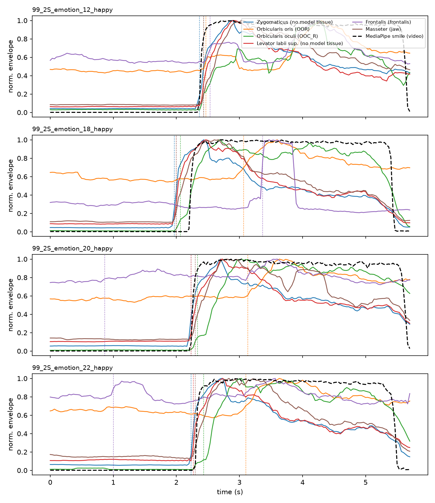

# B1 — Biological ground truth: muscle activation order during "happy"

**Question.** When a person smiles, in what order do the facial muscles switch on, how
consistent is that order, and does it match the motion order produced by the lab's
simulation (`a3-stochastic-V1`)?

**Caveat about the model.** The simulation uses a constant muscle activation
(`activation = 0.8`, `a3-stochastic-V1-algo/training/analysic_gradient/pytorch_analytical_gradient.py`),
so it has no activation *timing*. We therefore compare EMG onset order with the model's
tissue *motion* onset order, and real *video* motion onset with model motion onset.

## Data

Raw data lives in `data/` (gitignored, never commit it; MMM forbids redistribution).

| Dataset | Use | Subjects | Signal | License | Source |
|---|---|---|---|---|---|
| Mimetic Interfaces 2015 (Tampere) | main analysis | 15, 10 smiles each | raw sEMG 2048 Hz: zygomaticus, orb. oris, orb. oculi, corrugator / masseter (right side) | CC BY 4.0 | [research.fi](https://research.fi/en/results/dataset/0f24bf09-c5d1-422e-8df5-eb44219f5dec) |
| MMM sample (open part of MaM / EIFER) | cross-check + video motion | 1, 4 happy clips | 22-ch RMS envelope at 30 Hz (500 ms window) + video + MediaPipe blendshapes | see `LICENSE.md`, no redistribution | [zenodo 16636409](https://zenodo.org/records/16636409) |

Full MaM (many participants) is on request: <https://forms.gle/PBFzGwuSeMYMFVbz6>. Check with Viktor first.

## Method

`src/emg.py`:
- **Envelope** (raw data): remove DC → 4th-order Butterworth band-pass 20–450 Hz (zero phase)
  → notch at mains + harmonics → full-wave rectify → 6 Hz low-pass.
- **Onset**: first sample where the envelope exceeds max(baseline mean + 3 SD,
  baseline + 10 % of the rise to peak) for ≥ 50 ms (≥ 100 ms for 30 Hz data). Threshold rule after
  Hodges & Bui (1996). The 10 % floor stops smooth envelopes from firing on drift.
- **Activation ratio**: peak / baseline. Channels near 1 are treated as "not active".
- **Consistency**: Kendall's W across trials/participants, Kendall's τ between two orders.

`tests/test_emg.py` checks onsets are recovered on synthetic bursts with known timing.

## Results so far

### Mimetic Interfaces 2015 — main result (`src/mimetic_smile.py`)

12 participants (authors' exclusions 6, 7, 14 applied) × 10 voluntary smiles, raw 2048 Hz,
latency measured from the smile cue; baseline = the preceding neutral task.
Files are MATLAB `table` objects; read via `mat-io` (raw fields: `Eraw` µV, `L` task labels).



| | zygomaticus | orbicularis oculi | orbicularis oris | corrugator |
|---|---|---|---|---|
| peak / baseline | 8.6 | 4.3 | 2.9 | 1.3 (inactive; actually *relaxes*) |
| lag vs zygomaticus | — | **+35 ms**, later in 10/12, Wilcoxon p = 0.012 | **+188 ms**, later in 11/11, p = 0.001 | — |

- Order **zygomaticus → orbicularis oculi → orbicularis oris** in 8 of 11 participants with all three.
- Kendall's W between participants = **0.75** (strong agreement); within participants across
  10 trials median **0.53** (range 0.16–0.86): the order is a population tendency, with trial-to-trial variability.
- Same order as the independent MMM sample below.
- Caveats: orb. oris / oculi are low amplitude, so single-trial onsets are noisy; the small
  oculi lag (35 ms) could partly be crosstalk from zygomaticus; right side only; posed smiles.



### Model poses (`backup/b31 dataV22 backup hub` on `main`)

Mean vertex displacement from neutral (state `1`):

| Pose | OOR | OOC_L | OOC_R | Frontalis |
|---|---|---|---|---|
| AU12 | 2.8 | 0 | 0 | 0 |
| AU6 | 0.9 | 0.9 | 1.2 | 0 |
| AU6_12_25 | 5.2 | 1.3 | 1.6 | 0 |

The model's AU12 "smile" does not involve the eyes; **AU6_12_25 is the closest to "happy"** and matches
the EMG pattern (lips + eyes, no forehead). Only neutral→AU12 and neutral→AU6 trajectories exist
(GrUVi cloud disk, paths in `deformation_path_db.json`); neutral→AU12 and →AU12L point at the same job.

### MMM, 1 participant, 4 happy clips (`src/mmm_happy.py`)



- Order: **zygomaticus ≈ levator labii sup. ≈ masseter → video smile → orbicularis oculi → orbicularis oris (~0.9 s later)**.
- Orbicularis oris is only weakly active (peak/baseline 1.7) and rises late in 3/4 clips.
- Frontalis is not active in happy (1.5) → excluded from ordering.
- Kendall's W across the 4 clips: 0.50 (frontalis noise included; to recompute without it).
- Caveat: 30 Hz with a 500 ms RMS window → onset resolution ≈ 33 ms and onsets smeared early.

## Item 0: fair comparison at the electrode sites (`src/fair_compare.py`)

Richard's item 0: compare the model *at the spot of each MaM electrode* with that electrode,
instead of averaging a whole muscle.

**Inputs** (all local, gitignored under `data/`):
- MaM happy clips: 250 of 284 usable (20 participants); 34 skipped for a weak tracked smile.
- Model runs (from `wip/mam-validation-2026-11`): main `hpy` (job 261026-171605, neutral → AU6+AU12+AU25,
  1,772 steps), plus checks `au6` (neutral → AU6, 323 steps) and `au12` (neutral → AU12, 530 steps).
- Electrode positions `electrodes.json` (Fridlund placement on the lab head, by Oleh and Richard,
  branch `wip/mam-validation-2026-11`). Checked to be in the same coordinate space as the muscles:
  oculi electrodes sit 0.2–1.3 units and oris electrodes 2–5 units from their muscle.

**Method**
- Model (`model_run.py`): landmark path = rest + running sum of the stored per-step moves
  (verified: the sum equals the saved final positions exactly). No Maya needed.
  The happy run drives OOR, OOC_l, OOC_r; frontalis and jaw stay still.
- Full muscle mesh: vertex(t) = bind pose + skin weights × landmark moves, the lab's own LBS formula
  (`pytorch_analytical_gradient.LinearBlendSkinning`; bind poses and weights from `automation/` on
  `main`). Checked: the rebuilt final mesh equals the mesh the run saved (difference 0.000 for every
  muscle in all three runs). So the saved meshes are pure LBS; no Ziva physics is recorded on top.
- Virtual electrode (`virtual_electrode.py`): the first tissue layer directly under the electrode
  (within r = 1 cm sideways, 0.4 cm deep), Gaussian-weighted (σ = r/2). Under the oris electrodes the
  mesh has two layers separated by a gap (outer and inner lip surface); only the outer one is read.
  Per bipolar pair: shortening ε = 1 − |v1−v2|/|v1(0)−v2(0)| (+ contracting, − stretched) and
  translation of the pair midpoint.
- Human (`mam_happy.py`): a(t) = (envelope − rest) / session's 95th-percentile schaede level
  (0 = rest, ~1 = near-max effort); progress 0→1 from the tracked smile (MediaPipe mouthSmile).
- Common clock: model progress = net progress towards the final pose (1 − distance to end / start
  distance, running max). Not path length: the solver travels 2.6–3.1× further than the net
  displacement (it jitters), which would make real movement look early. Only shapes and signs are
  compared, never µV against movement.
- Noise ceiling: each participant's rise curve vs the median of everyone else (RMSE).

**Results** (`results_fair_compare_happy.csv`, `results_model_runs.csv`, `figures/fair_compare_happy.png`)

| Site | Humans (a at apex, % active) | Model | Verdict |
|---|---|---|---|
| Zygomaticus l/r | 0.84 / 0.92, 100% | not driven | missing agonist |
| Levator labii sup. l/r | 0.74 / 0.76, 100% | not driven | missing agonist (channel under question, see below) |
| Mentalis, depressor ang. oris | 0.20–0.38, 75–90% | not driven | missing agonist |
| Orbicularis oculi l/r | 0.32 / 0.18, 90–95% | `hpy`: stretched; AU6 alone: slightly shortened | composite reverses the sign |
| Orbicularis oris l/r | 0.37 / 0.41, 80–90% | `hpy`: stretched; AU12 alone: ~0 | stretched in the full smile |
| Frontalis, corrugator, procerus | ≈ 0, 0–10% | still | agree: silent |

- **Recruitment (robust):** the muscles doing most of the work in a human smile are not driven by the
  model at all. This holds by construction in every run.
- **Orbicularis oculi** (sign not robust to electrode placement, see the placement check below):
  humans contract it in a happy face (active in 90–95%). In the full happy run
  (AU6+AU12+AU25) the model stretches it at the electrode sites (left −7 to −10% at every patch size;
  right −0.2 to −10%, less stable because one right electrode gets only 36 vertices). In the AU6-only
  run it shortens slightly instead (left +0.8%, right +5.9%), the same direction as humans.
  The target-pose check below shows where this comes from.
- **Orbicularis oris** (sign not robust to electrode placement either): stretched at both sites in the
  full happy run at every patch size on the mesh
  (−2.5 to −26%; the earlier landmark-level sign flip came from inner-lip landmarks and is gone).
  In the AU12-only run it is about unchanged at the standard patch (−0.4/−1.2%).
- **Timing/shape** (net-progress clock, mesh): oculi rise is within the human spread (RMSE 0.08–0.19 vs
  a person-to-group median of 0.17). Oris rises somewhat earlier than in humans (half-way at 0.20 vs
  0.25–0.40; RMSE 0.19 vs ceiling median 0.11–0.14, 90th percentile 0.26–0.28), so inside the human
  range but towards its edge. Earlier versions of this table used a path-length clock and
  overstated this gap.

### Where the disagreements come from: target pose vs solver

The solver drives the muscles towards an artist-sculpted target pose (`dataV22_*.py`, index 1).
Reading the same electrode sites on the target itself (`target_eps_pct` in `results_model_runs.csv`):

| Run (target) | Site | Solver end | Target |
|---|---|---|---|
| hpy (AU6_12_25) | oculi l / r | −8.2% / −2.9% | −9.5% / −3.0% |
| hpy (AU6_12_25) | oris l / r | −8.3% / −13.4% | −8.1% / −13.9% |
| au6 (AU6) | oculi l / r | +0.8% / +5.9% | +0.3% / +6.2% |
| au12 (AU12) | oris l / r | −0.4% / −1.2% | −0.4% / −1.0% |

The solver lands within ~1% of the target at every site, so **where a muscle ends up is set by the
sculpted pose, not by the solver**:
- The eye-muscle stretch in happy is already in the AU6_12_25 sculpt.
- At the original electrode positions the AU6 sculpt shortens the right eye site (+6.2%) but barely the
  left (+0.3%). The placement check below shows this difference is within the spread from moving the
  electrodes 5 mm, so it is not evidence of an asymmetric sculpt.
- What the solver adds is the path: timing, the jitter (2.6–3.1× wasted motion) and transients such as
  the left eye in AU6 stretching first and shortening late.

So the three kinds of disagreement point to three different fixes: end states → re-sculpt the
targets; paths and timing → the optimizer; muscles never driven → add them to the model (item 1).

### Other expressions (same tool)

Same method, other MaM standardized tasks against the closest model run we have. Progress clock from
the task's own tracked movement (Eye-Tight: eyeBlink; Smile-Closed: mouthSmile). A site counts as
moving only if it moves ≥ 0.1 mm (a muscle driven elsewhere can be still under the electrode).

**Eye-Tight (75 clips, 20 participants) vs model neutral → AU6** (`results_fair_compare_eye-tight.csv`,
`figures/fair_compare_eye-tight.png`). AU6 is the closest run, not an exact match: Eye-Tight also
involves brow lowering and lid tightening.
- Orbicularis oculi: humans at 1.05–1.27 of their reference (this is the task that drives it hardest),
  100% active. Model right side shortens steadily (+5.9%) and its rise follows the human curve
  (RMSE 0.16, ceiling median 0.16): agreement. Model left side first stretches, then shortens late,
  ending near zero (+0.8%). The end value comes from the asymmetric AU6 sculpt (see above); the
  stretch-then-shorten path comes from the solver.
- Lips: silent in humans and still at the electrode sites in the model: agreement.
- Missing agonists: corrugator (0.53, 95% active), levator labii (0.29–0.42), medial frontalis (0.26).

**Smile-Closed (71 clips) vs model neutral → AU12** (`results_fair_compare_smile-closed.csv`)
- Zygomaticus 0.70–0.93 (95% active) and orbicularis oculi 0.19–0.25 (70–80%) active in humans;
  AU12 drives neither: missing agonists, as in happy.
- Orbicularis oris: weakly active in humans (0.15–0.19, 65%); the model moves the site without a clear
  length change, and earlier than the human EMG rises (half-way at 0.15 vs 0.60–0.65; RMSE 0.39–0.45,
  around the 90th percentile of person-to-group differences). With such a weak human signal, part of
  it may be crosstalk from zygomaticus.

### Recruitment matrix: all MaM tasks with a matching model target (`src/recruitment_matrix.py`)

Because the solver ends within ~1% of the target at every electrode site, the artist's target pose
tells us where each muscle ends up, also for expressions nobody has run yet (not the path).
For each task × electrode site: human hold level (90th percentile of a(t), rest from the session's
Face-At-Rest clip), against the target pose at that site (shortens > +2%, stretches < −2%,
moves without length change, still < 0.1 mm, or no driven muscle there).
`results_recruitment_matrix.csv`, `figures/recruitment_matrix.png`.

Pairs (FACS): Forehead–AU1, AU2; Eye-Tight–AU6; Smile-Closed–AU12; Smile-Open and happy–AU6_12_25;
Lip-Pucker–AU22 and phoneme UW (a pucker is AU18, which the model lacks); surprised–AU1, AU2
(brows only); angry–AU4 (brow lowering only). Tasks without a matching target are left out.

**Placement check.** Real electrode positions vary by several mm, so every electrode pair was also
shifted 5 mm in 8 directions (9 placements in all). A cell counts as robust if ≥ 8 of 9 placements give
the same model state (`results_recruitment_matrix_model_sites.csv`):

| Verdict | All cells | Robust to placement |
|---|---|---|
| agree: active | 6 | 4 |
| agree: silent | 26 | 16 |
| missing agonist | 15 | 14 |
| moves, no shortening | 9 | 2 |
| sign conflict | 10 | **0** |

What survives:
- **Missing agonists:** zygomaticus, corrugator, depressor anguli oris, mentalis, procerus, masseter are
  active in 70–100% of participants and the model has no driven muscle under them. This cannot depend
  on placement. Where the model does have a muscle, it stays still under active human sites in 14
  robust cells (e.g. medial frontalis in Eye-Tight and angry, orbicularis oculi in Smile-Closed).
- **Agreement:** the inner brow raise (AU1) shortens medial frontalis on both sides at every placement
  (+12 to +16%), in Forehead and in surprised.
- **Silent agreement** in 16 robust cells.

What does not survive:
- **No sign conflict is robust.** The happy / Smile-Open target mostly stretches oris and oculi
  (stretching in 62–88% of placements) but 5 mm away it can shorten (oris right −18% to +9%).
- **Left/right differences** reported earlier for AU6 (eye) and the UW pout (lips) are within the
  placement spread (AU6 right eye −6.7% to +5.9%). They are retracted.
- So the target poses deform the tissue very unevenly over a few millimetres, and one electrode site
  cannot settle "contracts vs stretches" for the lip and eye muscles. A fair comparison needs either
  per-participant electrode positions or a result averaged over the plausible placement area.

**Input problems found and excluded (to report, not interpret):**
- Target **AU7**: its eye and frontalis meshes are identical to AU6 (max difference 0.0000); only the lips
  differ. Lid tightening should change the eyes, so this looks like a copy in the pose file.
- MaM **"Lateraler Frontalis"** l/r: near rest in Forehead (0.02), active in Snarl, Nose, Lip-Pucker,
  Smile-Open; its task profile matches masseter/procerus (r ≈ 0.67), not frontalis.
- MaM **"Levator Labii Superioris"** l/r: peaks in Forehead (1.25) and tracks medial frontalis
  (r ≈ 0.7). Together with the point above this fits a swap of the two channels, but "Levator" is also
  high in happy (0.73), which fits real levator. Unresolved; both pairs are left out of the verdicts,
  and the levator "missing agonist" result for happy above should be treated as uncertain.

**Limits**
- EMG is the enabler, not force or movement; shortening is a stand-in for contraction
  (lip pressing gives EMG without shortening; crosstalk, especially around the mouth).
- MaM envelopes use a ~500 ms RMS window, so timing is blurred; posed expressions.
- Three model runs, one head. The meshes are LBS only: passive muscles (zygomaticus etc.) and any
  Ziva physics on top are not in the run files; reading those needs a replay in Maya.
- Model "l" is the participant's anatomical left (verified: the face looks towards −z, as the lips sit in
  front of the eyes and the jaw extends backwards; with y up, the participant's left is −x, where all
  "_l" muscles and electrodes are).
- Solver progress is not physiological time.

## Run

```bash
python3 -m venv .venv && .venv/bin/pip install numpy scipy pandas matplotlib mat-io
.venv/bin/python tests/test_emg.py && .venv/bin/python tests/test_fair_compare.py
cd src && ../.venv/bin/python mimetic_smile.py && ../.venv/bin/python mmm_happy.py
../.venv/bin/python fair_compare.py happy ../data/model/electrodes.json ../data/model/hpy ../data/model/au6 ../data/model/au12
../.venv/bin/python fair_compare.py eye-tight ../data/model/electrodes.json ../data/model/au6
../.venv/bin/python fair_compare.py smile-closed ../data/model/electrodes.json ../data/model/au12
../.venv/bin/python recruitment_matrix.py ../data/model/electrodes.json
```

## Citations

Büchner et al., CVPR 2025 (EIFER); Büchner et al., Acivs 2023 (MC-CycleGAN);
Guntinas-Lichius et al., Sci. Rep. 2023; Rantanen et al., Mimetic Interfaces dataset 2015;
Hodges & Bui, EEG Clin. Neurophysiol. 1996 (onset detection).
